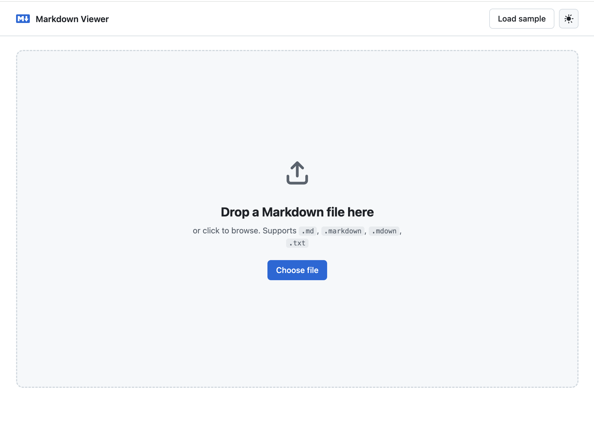

# Markdown Viewer

A lightweight, GitHub-flavored Markdown viewer that runs entirely in your browser. Drop in a `.md` file and it renders with GitHub-style formatting, syntax-highlighted code blocks, and light/dark themes. Nothing is uploaded anywhere, and all dependencies are bundled locally so it works offline.



## Features

- Renders [GitHub Flavored Markdown](https://github.github.com/gfm/) (tables, task lists, fenced code, and more)
- Syntax highlighting for code blocks, using the fence's language hint or auto-detection
- Light and dark themes, defaulting to your system preference and remembered across visits
- Drag and drop a file anywhere on the page, or click to browse
- Supports `.md`, `.markdown`, `.mdown`, `.mkd`, and `.txt` files (up to 5 MB)
- Rendered HTML is sanitized with DOMPurify, and external links open in a new tab
- Fully offline: `marked`, `DOMPurify`, and `highlight.js` live in `vendor/`
- `mdview` CLI for opening local files straight from the terminal

## Usage

### In the browser

Open `index.html` directly in a browser, then drop a Markdown file onto the page or click **Choose file**. Click **Load sample** to see a demo document.

### From the command line (`mdview`)

`mdview` is a small Bash script (macOS) that starts a local static server for the app and opens a file in your default browser.

```sh
mdview README.md   # open a specific file
mdview             # open the first .md file (alphabetically) in the current directory,
                   # or the landing page if there is none
mdview --kill      # stop the background server
```

To make it available everywhere, symlink it onto your `PATH`:

```sh
ln -s "$(pwd)/mdview" ~/bin/mdview
```

How it works:

- Serves the app directory with `python3 -m http.server` on port `8753` (override with `MDVIEW_PORT`). The server runs detached in the background and is reused by later invocations.
- Exposes the target file to the server via a symlink in `.mdview-docs/`.
- Opens `index.html?src=<file>`, which the app fetches and renders.

Requirements: `bash`, `python3`, `curl`, and `lsof` (all present on macOS by default).

## Project structure

| Path         | Description                                          |
| ------------ | ---------------------------------------------------- |
| `index.html` | App markup                                           |
| `app.js`     | Rendering, file loading, drag and drop, theme toggle |
| `style.css`  | GitHub-style Markdown and UI styles                  |
| `vendor/`    | Bundled `marked`, `DOMPurify`, and `highlight.js`    |
| `mdview`     | CLI launcher script                                  |
| `sample/`    | Example Markdown file                                |
